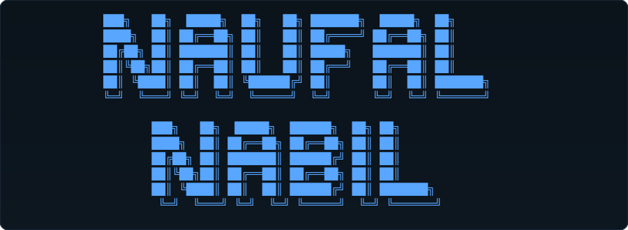

<div align="center">




<br />

`web development` · `linux ricing` · `neovim` · `terminal workflow`

</div>

```text
nabil-udah-kenyang / README.md

> whoami
  Nabil — web developer and Linux enthusiast

> current_mode
  building web apps · tuning my editor · making the terminal feel like home

> daily_driver
  Arch Linux + Hyprland + Neovim
```

## language map

<div align="center">


<br />

<sub>Live data from my public GitHub repositories · updates automatically without a workflow</sub>

</div>

## toolbox

<p>
  
  
  
  
  
  
  
  
  
  
</p>

<p>
  
  
  
  
  
  
  
</p>

## selected projects

<table>
  <tr>
    <td width="50%" valign="top">
      <h3><a href="https://github.com/nabil-udah-kenyang/lazyvim-config-nabil">lazyvim-config-nabil</a></h3>
      <p>Personal LazyVim configuration for a faster, cleaner coding setup.</p>
      <code>Lua</code> · <code>Neovim</code>
    </td>
    <td width="50%" valign="top">
      <h3><a href="https://github.com/nabil-udah-kenyang/Nvchad-Configuration-">Nvchad-Configuration</a></h3>
      <p>Pre-configured NvChad setup for a productive Neovim workflow.</p>
      <code>Lua</code> · <code>NvChad</code>
    </td>
  </tr>
  <tr>
    <td width="50%" valign="top">
      <h3><a href="https://github.com/nabil-udah-kenyang/starship-config-nabil">starship-config-nabil</a></h3>
      <p>Terminal prompt configuration with a clean look and useful shell context.</p>
      <code>Starship</code> · <code>Shell</code>
    </td>
    <td width="50%" valign="top">
      <h3><a href="https://github.com/nabil-udah-kenyang/MsLibrary-with-Payment-Gateway-and-Resend-email">MsLibrary</a></h3>
      <p>Digital library web app with payment gateway and email integration.</p>
      <code>Laravel</code> · <code>PHP</code>
    </td>
  </tr>
</table>

## currently learning

```text
backend architecture  ·  Laravel MVC  ·  clean code  ·  better Linux workflows
```

<div align="center">

<a href="https://github.com/nabil-udah-kenyang">
  
</a>

<br />

<sub>make it work · make it clean · then rice it a little</sub>

</div>
